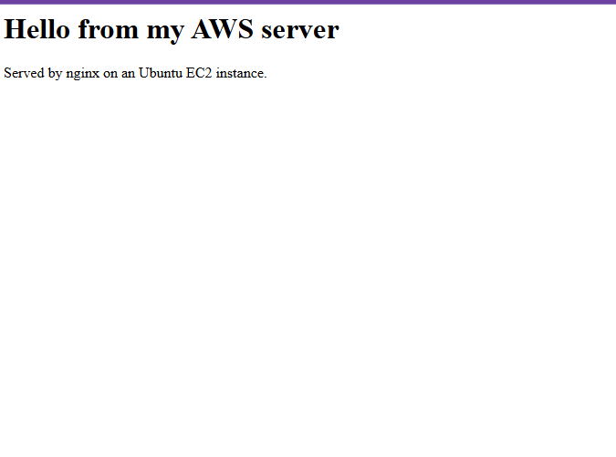
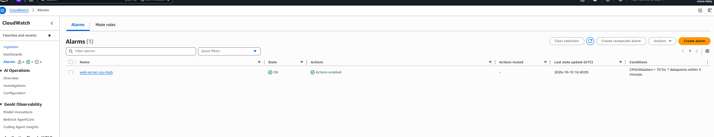
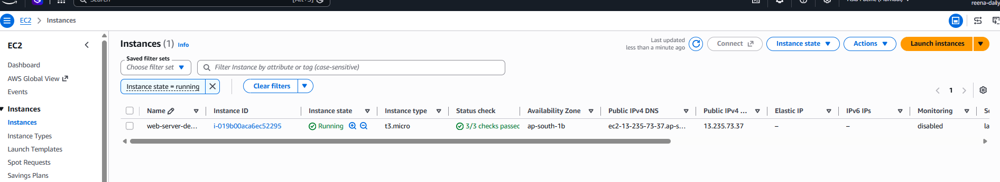

# aws-secure-web-server

# aws-secure-web-server

A small, secure web server on AWS EC2 with monitoring and cost controls. Built to learn the basics of AWS operations, then fully deleted at the end so nothing keeps costing money.

## What I built
- Ubuntu server on EC2 (t3.micro) in the Mumbai region
- nginx web server serving a custom page
- Security group: SSH allowed only from my own IP, HTTP open for the website, HTTPS closed
- Server firewall (ufw) allowing only SSH and nginx
- CloudWatch alarm that emails me through SNS when average CPU stays above 70% for 5 minutes

## Account safety and cost control
- A daily-use IAM user with limited permissions instead of the root account
- A zero-spend budget alert that emails me if any charge appears
- Free plan account, and every resource deleted after the project

## Steps
1. Set up the billing alert and the IAM user
2. Launched an Ubuntu EC2 instance with a key pair and a restricted security group
3. Connected over SSH and installed nginx
4. Enabled the firewall and installed updates
5. Created the CloudWatch CPU alarm with an SNS email notification
6. Deleted the instance and the alarm

## Screenshots
   

## What I learned
Least-privilege access, how security groups and a server firewall work together, basic monitoring, and why cleanup matters on cloud accounts.

## Tools
AWS EC2, IAM, CloudWatch, SNS, Ubuntu, nginx, ufw, SSH
